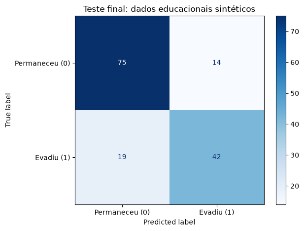
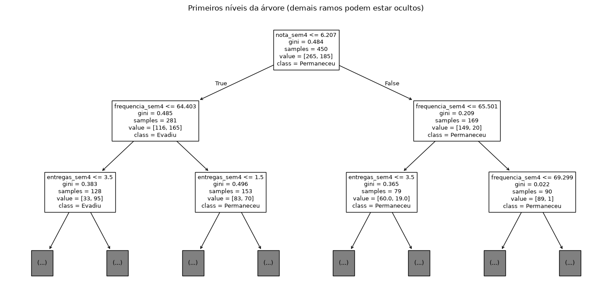

**Profa. Kadidja Valéria | UDF**  
Ciência de Dados e Aprendizado de Máquina · Sistemas de Informação · 2026.2

# Aula 2 — Registro do laboratório supervisionado

## Identificação

- Estudante ou equipe: **Gabriel Landim Donadel de Farias e Rafael Batista Mota**
- Turma: **Sistemas de Informação — UDF, 2026.2**
- Data de realização: **25/11/2026**
- Integrantes e contribuições (se em equipe): **Gabriel: execução do notebook e experimentos de classificação (seções 1, 3 a 5). Rafael: preparação, regressão e interpretação (seções 2 e 6). Os dois: conclusão (seção 7).**

## Percurso escolhido

- [x] Python/Colab ou Jupyter.
- [ ] Orange Data Mining.

Use o [notebook de apoio](notebooks/laboratorio.ipynb) ou o [CSV sintético](dados/educacionais-sinteticos.csv). O CSV contém 600 registros fictícios. Atributos: `frequencia_sem4`, `nota_sem4`, `entregas_sem4`. Alvo: `evasao_fim_semestre` (0 permaneceu, 1 evadiu). As associações foram definidas pela simulação, sem validade empírica sobre estudantes reais.

## 1. Ambiente e reprodução

| Item | Registro |
| --- | --- |
| Ambiente e data | Jupyter (nbconvert) local, Windows 11, em 25/11/2026. O notebook também roda no Colab |
| Versões das ferramentas/bibliotecas | Python 3.11.9, NumPy 2.4.6, pandas 3.1.1, matplotlib 3.11.2, scikit-learn 1.9.1 |
| Semente aleatória | 42 (`SEMENTE = 42` na geração dos dados, na divisão, na validação cruzada e nas árvores) |
| Caminho do notebook executado ou fluxo Orange | [notebooks/laboratorio-equipe.ipynb](notebooks/laboratorio-equipe.ipynb), com resultados também em [notebooks/resultados_execucao.json](notebooks/resultados_execucao.json) |
| Origem dos dados e condição sintética | Gerados pela simulação do próprio notebook (600 registros; probabilidade de evasão definida por uma função logística com ruído). **Sintéticos**, sem estudantes reais |

## 2. Problema e preparação

- Pergunta de negócio: **Quais estudantes poderiam receber um convite voluntário de apoio antes do fim do semestre, com base no que se sabe até a semana 4?**
- Unidade de análise e horizonte: **Um estudante fictício. A previsão é feita na semana 4 sobre a evasão até o fim do semestre.**
- Atributos disponíveis no instante da previsão: **`frequencia_sem4` (%), `nota_sem4` (0–10) e `entregas_sem4` (0–8), todos observados até a semana 4.**
- Variável-alvo e sua natureza: **`evasao_fim_semestre`, categórica binária (0 = permaneceu, 1 = evadiu). Tarefa de classificação. Distribuição: 59% permaneceram e 41% evadiram.**
- Ausências e outros problemas encontrados: **30 valores ausentes em `nota_sem4` (5%), introduzidos de propósito. Não há ausentes nos outros atributos nem no alvo.**
- Tratamentos e conjunto usado para aprendê-los: **Imputação pela mediana (`SimpleImputer`) dentro de um `Pipeline`, aprendida só com os dados de treino de cada etapa. Na validação cruzada, ela é reaprendida em cada parte. O teste nunca participa da mediana. A árvore não precisa de padronização.**

## 3. Desenvolvimento e teste

- Método de divisão e justificativa: **`train_test_split` com 25% para teste, `stratify=y` e `random_state=42`. A divisão aleatória e estratificada é adequada porque as observações simuladas são independentes e assim a proporção de classes se mantém. Com turmas reais, seria preciso reservar períodos futuros.**
- Quantidades de treino e teste: **450 de treino e 150 de teste.**
- Procedimento de validação no treino: **Validação cruzada estratificada em 5 partes (`StratifiedKFold`, `shuffle=True`, semente 42), métrica de acurácia, registrando média e desvio.**
- Parâmetros da árvore e como foram escolhidos: **`max_depth=5` e `min_samples_leaf=10`. A profundidade foi escolhida entre 2, 3, 5 e sem limite pela maior acurácia média de validação no treino (0,7222 ± 0,0391).**
- Como o teste ficou fora da seleção: **O teste só foi usado uma vez, depois de escolher e treinar o modelo final. Os experimentos posteriores (seção 5) também usaram só a validação cruzada no treino.**

### Alternativa Orange

Confira o alvo como categórico. Registre as conexões: File/Select Columns → Test & Score (Data), Tree → Test & Score (Learner), Test & Score → Confusion Matrix (Evaluation Results). Data Table permite inspeção. Se usar Preprocess, conecte o preprocessor ao learner para ajustar transformações dentro do treino. Não use apenas `Test on train data` como avaliação final.

**Fluxo e método de avaliação realmente utilizados:** **Não se aplica: a equipe usou o percurso Python. A avaliação foi validação cruzada estratificada em 5 partes no treino para escolher o modelo, mais um teste independente de 150 registros para o resultado final.**

Se comparar configurações, use validação no treino e reserve teste independente. Documente em Test & Score as entradas Data e Test Data, quando utilizadas.

## 4. Resultados calculados de classificação

| Modelo | Configuração | Acurácia de treino | Acurácia de validação e dispersão | Acurácia de teste |
| --- | --- | --- | --- | --- |
| Referência | `DummyClassifier(strategy="most_frequent")`: sempre prevê 0 | 0,5889 | 0,5889 ± 0,0000 | 0,5933 |
| Árvore final | Imputação pela mediana + árvore `max_depth=5`, `min_samples_leaf=10` | 0,8133 | 0,7222 ± 0,0391 | **0,7800** |

**Matriz: linhas reais e colunas previstas; classe positiva = 1.**

| Real / previsto | Permaneceu (0) | Evadiu (1) |
| --- | --- | --- |
| Permaneceu (0) | 75 (TN) | 14 (FP) |
| Evadiu (1) | 19 (FN) | 42 (TP) |

- Acurácia calculada manualmente pela matriz: **(75 + 42) / 150 = 117 / 150 = 0,78**
- Sensibilidade da classe 1: **TP / (TP + FN) = 42 / 61 = 0,689**
- Comparação com referência: **A árvore acerta 0,78 contra 0,593 da referência (+18,7 pontos percentuais). A referência tem sensibilidade 0, porque nunca prevê evasão. A árvore encontra 69% de quem evadiu.**
- Consequências dos falsos positivos: **14 estudantes que permaneceriam receberiam um convite de apoio desnecessário. O custo é baixo se o contato for voluntário e acolhedor, mas é preciso evitar estigma ("você foi marcado como risco").**
- Consequências dos falsos negativos: **19 estudantes que evadiram não seriam sinalizados e ficariam sem o convite. É o erro mais grave nesse uso. Por isso o apoio deve estar aberto a todos, não só aos sinalizados.**
- Interpretação do gráfico e da árvore: **Os histogramas mostram atributos distribuídos de forma ampla. Na validação, a nota foi o atributo mais útil: retirá-la derruba a acurácia de 0,722 para 0,629. A primeira pergunta da árvore é "nota ≤ 6,2?". Abaixo disso há 165 evasões em 281 casos de treino. Acima, há 20 em 169 casos, e, com frequência acima de 69%, só 1 em 90. Os níveis seguintes usam frequência e entregas. Isso mostra associação na simulação, não causa. A estimativa de 0,342 para o novo registro (frequência 72, nota 6, entregas 5) é a proporção de evasão na folha, não uma probabilidade calibrada.**

## 5. Experimentos no treino

Compare parâmetros usando apenas treino/validação. Após conhecer o teste, uma nova seleção exige novo teste independente para avaliação final.

| Experimento | Alteração | Resultado de validação | Interpretação |
| --- | --- | --- | --- |
| 1 | `min_samples_leaf` em 5, 10, 20 e 40, combinado com profundidade 2, 3, 5 e sem limite | Melhor: folha 40 → 0,7289 ± 0,0303 (lacuna treino−validação de 0,047). Sem limite e folha 5 → 0,7133 (lacuna de 0,154) | Folhas maiores reduzem o sobreajuste. A diferença para o modelo escolhido (0,7222) é menor que a dispersão, então os dois são equivalentes. Como o teste já foi visto, trocar exigiria um novo teste independente, e mantivemos o modelo |
| 2 | Retirar um atributo de cada vez (profundidade 5, folha 10) | Nenhum: 0,7222. Sem frequência: 0,7156. Sem nota: **0,6289**. Sem entregas: 0,7022 | A nota é o atributo mais informativo nesta simulação. A frequência acrescenta pouco quando nota e entregas estão presentes |

Responda:

1. Como a profundidade e o tamanho das folhas podem afetar o sobreajuste? **Árvores profundas e com folhas pequenas criam regras muito específicas, que decoram o treino. Sem limite e com folha 5, o treino chegou a 0,868 e a validação ficou em 0,713. Limitar a profundidade ou exigir folhas maiores (20–40) obriga cada regra a valer para mais casos, o que reduz a lacuna (0,05–0,06) e melhora a generalização. Limitar demais (profundidade 2) causa subajuste: 0,684 tanto no treino quanto na validação.**
2. Retirar um atributo e observar mudança no desempenho prova causalidade? **Não. Mostra só que o atributo carrega informação útil para prever, dados os outros. A queda pode vir de correlação com causas não medidas (trabalho, saúde, transporte), e atributos correlacionados podem se substituir. Além disso, aqui a "verdade" foi definida pela função da simulação. Provar causa exigiria um desenho experimental ou causal, não só desempenho preditivo.**
3. Se 95% permanecem, o que acontece com um modelo que sempre prevê permanência? **Ele teria 95% de acurácia e sensibilidade zero. Calculamos no notebook: matriz [[95, 0], [5, 0]], com todos os 5 que evadiram como falsos negativos. A acurácia parece ótima, mas o modelo é inútil para o objetivo. Por isso é preciso olhar a matriz, a sensibilidade e a comparação com a referência.**

## 6. Regressão — seção independente

Execute a seção da biblioteca no notebook ou registre o procedimento equivalente em Orange. Dados também sintéticos. Alvo numérico: empréstimos por semana.

| Item | Registro |
| --- | --- |
| Atributos e alvo | Atributos: `usuarios_ativos` (100–1.000) e `horas_abertura` (20–60). Alvo: `emprestimos_semana` (contínuo) |
| Divisão e preparação | 300 registros sintéticos; `train_test_split` com 25% de teste (225 de treino e 75 de teste), semente 42; imputação pela mediana no `Pipeline` (não há ausentes); regressão linear |
| MAE do modelo e unidade | **28,59 empréstimos por semana** |
| MAE da referência | **84,73 empréstimos por semana** (`DummyRegressor`, média do treino) |
| R² do teste | **0,8774** |
| Interpretação do gráfico observado/previsto | Os pontos ficam próximos da diagonal "previsão igual ao observado", sem curvatura, então o modelo acompanha bem a demanda simulada em toda a faixa. Coeficientes: +0,348 empréstimo por usuário ativo e +2,30 por hora de abertura (associação, não efeito causal) |
| Interpretação dos resíduos | Média de −1,28, desvio de 35,5 e intervalo de −87 a +65, espalhados em torno de zero sem padrão em relação ao previsto. Não há viés sistemático. O ruído restante é o que a própria simulação acrescentou |
| Limitação de extrapolação | O treino cobre 107–993 usuários e 20–60 horas. Para 10.000 usuários, o modelo prevê 3.609 empréstimos, um valor fora do domínio observado. Nada garante que a relação continue linear (há limites de acervo e de atendimento), e o valor não deve ser usado |

Explique por que R² não é porcentagem de acertos: **O R² compara o erro quadrático do modelo com o de prever sempre a média do conjunto avaliado: R² = 1 − SQ_erro / SQ_total. Um R² de 0,877 significa que o modelo reduz em 87,7% esse erro quadrático em relação à média. Não significa que 87,7% das previsões "acertaram". Numa regressão não há acerto ou erro binário, e cada previsão erra por algum valor (aqui, em média, 28,59 empréstimos). O R² também pode ser negativo, quando o modelo é pior que a média.**

## 7. Evidências e conclusão

- Link relativo do notebook/fluxo: **[notebooks/laboratorio-equipe.ipynb](notebooks/laboratorio-equipe.ipynb), além de [notebooks/resultados_execucao.json](notebooks/resultados_execucao.json)**
- Links das imagens, se houver: **[assets/matriz-confusao-laboratorio.png](assets/matriz-confusao-laboratorio.png) e [assets/arvore-laboratorio.png](assets/arvore-laboratorio.png). Os outros gráficos (histogramas, observado × previsto e resíduos) estão salvos como saídas no notebook executado.**

- Principal aprendizado: **Escolher o modelo só com a validação no treino e usar o teste uma única vez. A árvore teve 0,78 de acurácia no teste contra 0,593 da referência, mas a matriz mostrou 19 falsos negativos que a acurácia sozinha esconde.**
- Limitações de generalização e vieses possíveis: **Os dados são sintéticos e as relações foram definidas por uma função. Há uma única divisão de teste com 150 casos (a acurácia tem incerteza de alguns pontos). Não há avaliação temporal nem grupos reais para auditar equidade. Com dados reais, estudantes com menos registros, como os que trabalham ou estudam à noite, podem ser mal representados.**
- Cuidados com privacidade e uso responsável: **Usar o mínimo de dados, com acesso restrito à equipe de apoio, retenção limitada ao semestre e sem identificadores no modelo. A sinalização gera só um convite voluntário, com revisão humana e possibilidade de contestação, nunca punição ou decisão automática.**

Para inserir uma imagem salva, use `` e confira se o arquivo existe. Mostre apenas dados sintéticos.

[Voltar ao início](README.md).
