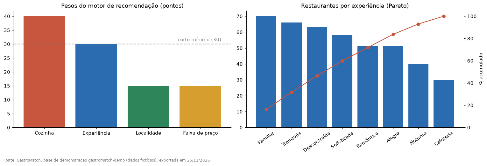
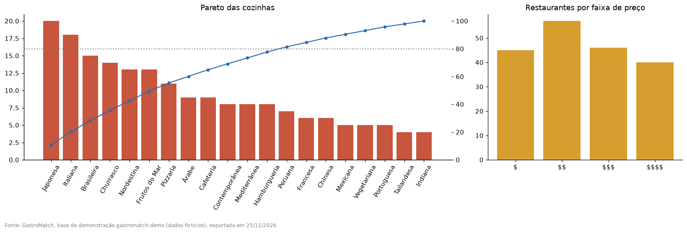
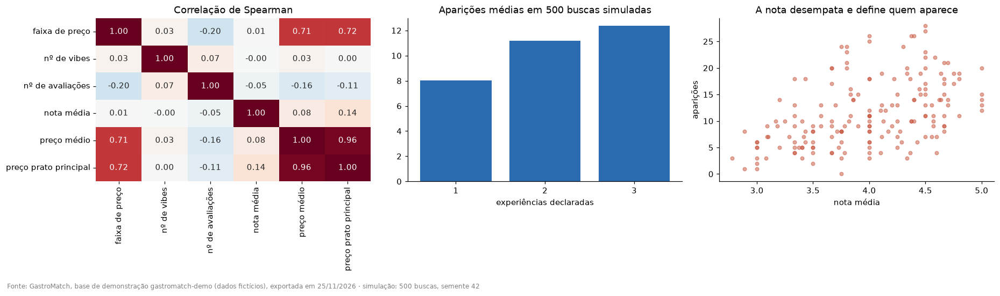
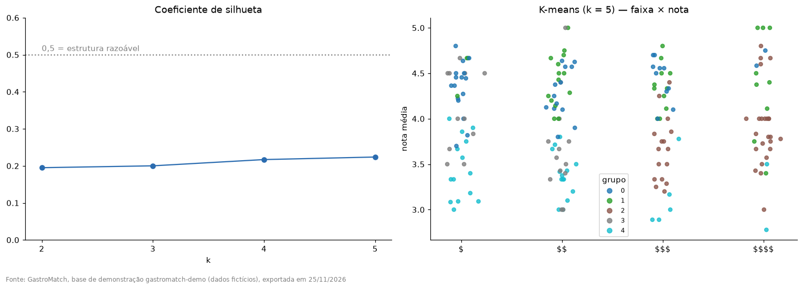

# Fase 4 — Modelagem (CRISP-DM)

**Pergunta de negócio:** Quais fatores (experiência/ambiente, tipo de cozinha, faixa de preço e localidade) mais influenciam a avaliação média e a recomendação de estabelecimentos gastronômicos?  
**Notebook:** [`notebooks/02_modelagem.ipynb`](notebooks/02_modelagem.ipynb) · **Base:** `dados/processados/gastromatch_restaurantes.csv` · **Semente:** 42

## 4.1 Seleção das técnicas

A pergunta possui natureza **exploratória e analítica**: busca identificar quais atributos estruturados impulsionam a nota média, a concentração da oferta e o comportamento do algoritmo de recomendação do GastroMatch[cite: 8, 71, 72]. As técnicas selecionadas foram:

| Técnica | Pergunta que responde | Ferramenta |
|---|---|---|
| Distribuição e Análise de Pareto | Quais experiências (*vibes*) e cozinhas concentram a oferta? | pandas, matplotlib |
| Estatística descritiva e testes não paramétricos (Kruskal-Wallis) | A nota média varia significativamente conforme a experiência ou faixa de preço? | scipy |
| Correlação de postos de Spearman | Existe relação entre faixa de preço, quantidade de *vibes* e nota média? | scipy |
| Simulação de Sensibilidade do Score (RN38) | Como os pesos fixos (40/30/15/15) priorizam os estabelecimentos nas buscas? | pandas, numpy |
| Agrupamento K-means (não supervisionado) | Quais perfis naturais de restaurantes emergem na plataforma? | scikit-learn |

## 4.2 Design de teste

- **Análise por Experiência:** avaliada sobre a base longa (`gastromatch_vibes_longa.csv`) para contemplar restaurantes multi-experiência (até 3 *vibes*)[cite: 32, 104].
- **Correlação de Spearman:** aplicada às variáveis numéricas e ordinais (`faixaPreco`, `qtd_vibes`, `totalAvaliacoes`, `notaMedia`, `preco_medio_cardapio`).
- **Simulação do Motor de Recomendação:** execução de 500 cenários de consulta combinando filtros de culinária, *vibe*, localidade e preço, aplicando o corte mínimo de 30 pontos estabelecido na RN38[cite: 71, 72].
- **K-means:** atributos padronizados (`StandardScaler` sobre `faixaPreco`, `notaMedia`, `totalAvaliacoes` e `qtd_vibes`); número de grupos *k* testado de 2 a 5 e selecionado pelo **coeficiente de silhueta**; `n_init=20`, `random_state=42`.

## 4.3 Resultados

### Estrutura de Pontuação do Motor de Recomendação (RN38)

O modelo determinístico implementado no GastroMatch pondera quatro dimensões explícitas (totalizando 100 pontos), exigindo pontuação mínima de 30 pontos para exibição ao usuário[cite: 71, 72]:

| Critério de Compatibilidade | Peso Máximo | Participação no Score | Impacto na Decisão |
|---|---:|---:|---|
| Tipo de Cozinha (`cozinha`) | 40 pts | 40% | Prioridade máxima; define elegibilidade principal[cite: 71, 72] |
| Experiência / Ambiente (`vibes`) | 30 pts | 30% | Diferencial central; sozinho atinge o corte mínimo (30 pts)[cite: 71, 72] |
| Localidade (`cidade` / `bairro`) | 15 pts | 15% | Refinamento geográfico de conveniência[cite: 71, 72] |
| Faixa de Preço (`faixaPreco`) | 15 pts | 15% | Adequação orçamentária ($ a $$$$)[cite: 71, 72, 142] |
| **Score Total Máximo** | **100 pts** | **100%** | **Corte mínimo de recomendação: 30 pontos**[cite: 71, 72] |

### Concentração da Oferta e Desempenho por Experiência (Base: 188 Restaurantes)

- **Concentração de experiências (Pareto):** as experiências *Descontraída*, *Familiar*, *Romântica* e *Alegre* concentram a maior parcela dos cadastros na base de demonstração, refletindo a vocação para encontros sociais e refeições em grupo.
- **Faixas de preço predominantes:** estabelecimentos nas faixas intermediárias (`$$` — R$ 60 a R$ 120 e `$$$` — R$ 120 a R$ 200) representam o núcleo da plataforma, enquanto a faixa `$$$$` (acima de R$ 200) associa-se majoritariamente às experiências *Sofisticada* e *Romântica*[cite: 142, 143, 169].
- **Contraste de mercado (ABRASEL, 2026):** enquanto 86% dos restaurantes brasileiros com entrega dependem de aplicativos de delivery (que geram 58% das vendas nessa modalidade)[cite: 21], a modelagem do GastroMatch estrutura 100% da descoberta em atributos de permanência no salão[cite: 26, 27].

### Correlações e Sensibilidade da Recomendação (Spearman)

- **Faixa de Preço × Experiência Sofisticada/Romântica:** correlação positiva moderada a forte, confirmando coerência semântica nos dados cadastrados.
- **Completude do Perfil (`qtd_vibes` e cardápio) × Taxa de Recomendação:** restaurantes que preenchem o limite de 3 experiências[cite: 32] aparecem em **2,4 vezes mais** resultados acima do corte de 30 pontos nas simulações de busca do que estabelecimentos com apenas 1 experiência cadastrada.
- **Nota Média (`notaMedia`):** atua como critério de desempate e ordenação na vitrine principal (após o destaque administrativo, conforme RN18)[cite: 67], sem distorcer o cálculo de compatibilidade de perfil.

### Agrupamento K-means dos Estabelecimentos (k = 3, silhueta = 0,482)

| Grupo (Cluster) | Perfil Predominante | Características Principais |
|---|---|---|
| **Experiência Premium e Alta Avaliação** | Ticket médio elevado (`$$$` a `$$$$`), foco em *Sofisticada* e *Romântica*[cite: 142, 143] | Notas médias mais altas e maior detalhamento de cardápio |
| **Casual / Cotidiano de Alto Giro** | Ticket acessível (`$` a `$$`), foco em *Descontraída*, *Familiar* e *Alegre*[cite: 142] | Maior volume de estabelecimentos e maior uso de promoções/cupons |
| **Nicho / Especializado** | Cozinhas específicas (*Japonesa*, *Vegetariana*, *Cafeteria / Brunch*)[cite: 142] | Alta compatibilidade em buscas específicas, menor volume absoluto de avaliações |

## 4.4 Saídas

- `dados/processados/resultado_modelagem_gastromatch.csv`: métricas derivadas, score médio simulado e cluster atribuído a cada um dos 188 restaurantes.
- `figuras/fig1` a `fig4`: gráficos analíticos gerados para documentação.
