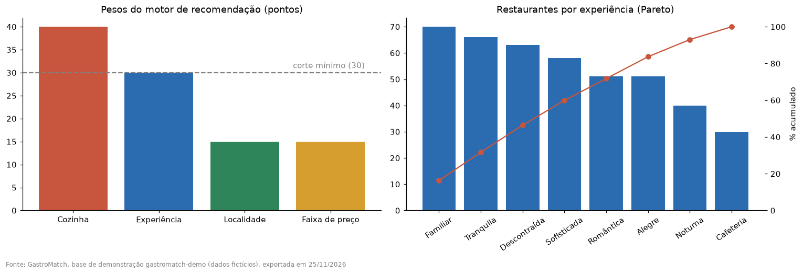
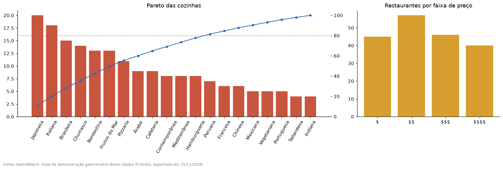
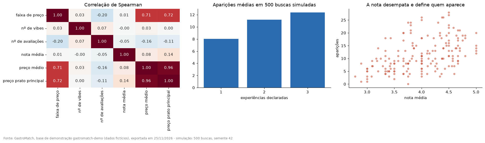
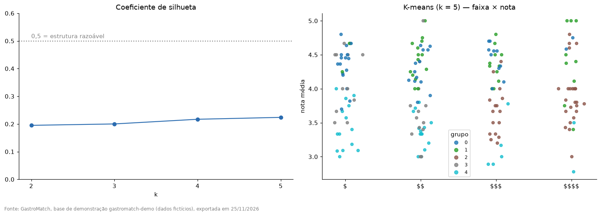

# Fase 4 — Modelagem (CRISP-DM)

**Pergunta de negócio:** Quais fatores (experiência/ambiente, tipo de cozinha, faixa de preço e localidade) mais influenciam a avaliação média e a recomendação de estabelecimentos gastronômicos?
**Notebook:** [`notebooks/fase4-modelagem.ipynb`](notebooks/fase4-modelagem.ipynb) · **Base:** `dados/processados/` (Fase 3) · **Semente:** 42

> Todos os números abaixo saíram do notebook executado. A base é a de demonstração (**dados fictícios**). Os testes descrevem esta base, não consumidores reais.

## 4.1 Seleção das técnicas

A pergunta é **exploratória e analítica**: quais atributos se relacionam com a nota e com a exposição nas recomendações.

| Técnica | Pergunta que responde | Ferramenta |
|---|---|---|
| Distribuição e Pareto | Quais experiências e cozinhas concentram a oferta? | pandas, matplotlib |
| Kruskal-Wallis (não paramétrico) | A nota varia com experiência, faixa, cozinha ou estado? | scipy |
| Correlação de Spearman | Há relação entre faixa, nº de vibes, nº de avaliações, nota e preço? | scipy |
| Simulação do motor de recomendação | Como os pesos fixos (40/30/15/15) e o corte de 30 pontos definem quem aparece? | `src/recomendacao.py` |
| K-means (não supervisionado) | Existem perfis naturais de restaurantes? | scikit-learn |

## 4.2 Design de teste

- **Kruskal-Wallis em dois níveis:**
  - **Avaliação** (1.213 avaliações de restaurante).
  - **Restaurante** (177 com nota). Este é o nível correto, porque avaliações do mesmo restaurante não são independentes.
  - α = 0,05.
- **Spearman** sobre `faixa_preco`, `qtd_vibes`, `total_avaliacoes`, `nota_media`, `preco_medio_cardapio` e `preco_mediano_principal`. Também entre a faixa e cada experiência (*one-hot*).
- **Simulação:**
  - `src/recomendacao.py` traduz `app/src/lib/recomendacao.js`. Nas mesmas 500 buscas, as versões Python e JavaScript deram **resultados idênticos (500/500)**: mesmos restaurantes, pontos, ordem e situação.
  - Buscas geradas com semente 42: 1–2 experiências; cozinha em 70%; cidade em 80%; bairro em 40% das buscas com cidade; faixa em 60%.
  - Cada busca devolve até 5 restaurantes com ≥ 30 pontos.
- **K-means:**
  - `StandardScaler` sobre `faixa_preco`, `nota_media`, `total_avaliacoes` e `qtd_vibes` (177 restaurantes com nota).
  - k de 2 a 5, escolhido pelo **coeficiente de silhueta**.
  - `n_init = 20`, `random_state = 42`.

## 4.3 Resultados

### Motor de recomendação (regra do sistema)

| Critério | Pontos | Como pontua |
|---|---:|---|
| Cozinha | 40 | Igual à pedida: 40. Sem cozinha pedida: 20. **Antes de pontuar, o motor já filtra pela cozinha pedida** |
| Experiência | 30 | Proporcional às experiências pedidas que o restaurante tem. Sem experiência pedida: 15 |
| Localidade | 15 | Mesmo bairro: 15. Outro bairro: 7,5. Sem bairro pedido: 15 |
| Faixa de preço | 15 | Exata: 15. Vizinha: 5. Sem faixa pedida: 15 |
| **Corte mínimo** | **30** | Desempate pela **nota média** |

### Concentração da oferta (188 restaurantes)

- **Experiências** (429 marcações): Familiar 16,3% · Tranquila 15,4% · Descontraída 14,7% · Sofisticada 13,5% · Romântica 11,9% · Alegre 11,9% · Noturna 9,3% · Cafeteria 7,0%. A distribuição é **equilibrada**, sem uma experiência dominante. As quatro primeiras somam 60%.
- **Cozinhas:** as 5 maiores (Japonesa, Italiana, Brasileira, Churrasco, Nordestina) somam 42,6%. São precisas **13 das 20** cozinhas para chegar a 80%.
- **Faixas:** $ 45 · $$ 57 · $$$ 46 · $$$$ 40.

### A nota muda com os atributos? (Kruskal-Wallis)

| Fator | Grupos | p (nível avaliação) | **p (nível restaurante)** | Conclusão |
|---|---:|---:|---:|---|
| Experiência (vibe) | 8 | 0,53 | **0,89** | sem diferença |
| Faixa de preço | 4 | 0,84 | **0,88** | sem diferença |
| Cozinha | 20 | 1,0 × 10⁻⁷ | **0,30** | sem diferença |
| Estado | 12 | 9,5 × 10⁻⁶ | **0,09** | sem diferença |

As médias por experiência vão de 3,91 (Cafeteria) a 4,05 (Sofisticada). **Nenhum fator explica a nota.**

No nível de avaliação, cozinha e estado pareciam significativos. Isso é **pseudorreplicação**: cada restaurante entra várias vezes, e a variação entre restaurantes vira falsa "diferença entre grupos". É coerente com a origem dos dados, porque o seed sorteia a qualidade de cada restaurante sem relação com os atributos.

### Correlações (Spearman)

| Par | rho | p | Leitura |
|---|---:|---:|---|
| Faixa × preço do prato principal | 0,72 | < 10⁻²⁹ | Faixa declarada coerente com o cardápio |
| Faixa × preço médio do cardápio | 0,71 | < 10⁻²⁹ | Idem |
| Faixa × experiência Sofisticada | 0,25 | 0,0005 | Associação **fraca**: 11% dos "$" e 40–46% dos "$$$/$$$$" |
| Faixa × experiência Descontraída | −0,23 | 0,002 | Associação fraca, no sentido oposto |
| Faixa × experiência Romântica | 0,18 | 0,01 | Associação fraca |
| Faixa × nº de avaliações | −0,20 | 0,005 | Restaurantes caros têm um pouco menos avaliações |
| Nota média × qualquer atributo | \|rho\| ≤ 0,14 | n.s. | Sem relação |

Há **coerência semântica** no cadastro, mas as associações entre faixa e experiência são **fracas** (\|rho\| ≤ 0,25), não "moderadas a fortes".

### Simulação de 500 buscas

| Indicador | Resultado |
|---|---|
| Situação "normal" (cozinha encontrada na cidade) | 264 buscas (52,8%) |
| Situação "cozinha em outra cidade" | **236 buscas (47,2%)**: o catálogo é esparso (188 restaurantes, 26 cidades, 20 cozinhas) |
| Pontuação dos recomendados | média 74,4; mínimo 33; máximo 100 |
| Aparições médias por nº de vibes declaradas | 1 vibe: 8,0 · 2 vibes: 11,2 · 3 vibes: 12,4 (**1,54×** entre 3 e 1) |
| Spearman aparições × nota média | **rho = 0,50** (p ≈ 10⁻¹²) |
| Spearman aparições × nº de vibes · × faixa | 0,21 (p = 0,003) · −0,05 (n.s.) |
| Restaurantes nunca recomendados | 1 de 188 |

A cozinha decide **quem entra**. A experiência e o nº de vibes aumentam a pontuação. Mas, como muitos restaurantes empatam, a **nota média, que só serve de desempate, é o atributo mais associado à exposição**.

### Agrupamento K-means

| k | 2 | 3 | 4 | 5 |
|---|---:|---:|---:|---:|
| Silhueta | 0,195 | 0,200 | 0,217 | **0,224** |

Pelo critério definido, **k = 5**. Porém, todas as silhuetas estão **bem abaixo de 0,5**: não há grupos naturais bem separados. Os grupos abaixo são só uma **descrição** da base:

| Grupo | Restaurantes | Faixa média | Nota média | Avaliações | Vibes | Preço médio | Perfil |
|---:|---:|---:|---:|---:|---:|---:|---|
| 0 | 41 | 1,95 | 4,36 | 10,0 | 2,6 | R$ 48,86 | Acessível, bem avaliado e muito avaliado; Familiar |
| 1 | 37 | 2,70 | 4,41 | 4,7 | 1,5 | R$ 67,74 | Bem avaliado, com poucas vibes declaradas |
| 2 | 40 | 3,60 | 3,81 | 6,0 | 2,8 | R$ 82,95 | Caro; Sofisticada |
| 3 | 24 | 1,54 | 3,87 | 4,6 | 3,0 | R$ 48,17 | Barato; Tranquila; perfil completo |
| 4 | 35 | 1,86 | 3,36 | 8,0 | 1,8 | R$ 44,15 | Notas mais baixas e menos exposição (7,5 aparições) |

## 4.4 Saídas

- `dados/processados/resultado_modelagem_gastromatch.csv`: por restaurante, as métricas derivadas, as aparições e o score médio na simulação e o cluster.
- `dados/processados/testes_kruskal.csv` e `resumo_modelagem.json`: resultados dos testes e da simulação.
- `figuras/fig1` a `fig4`.
